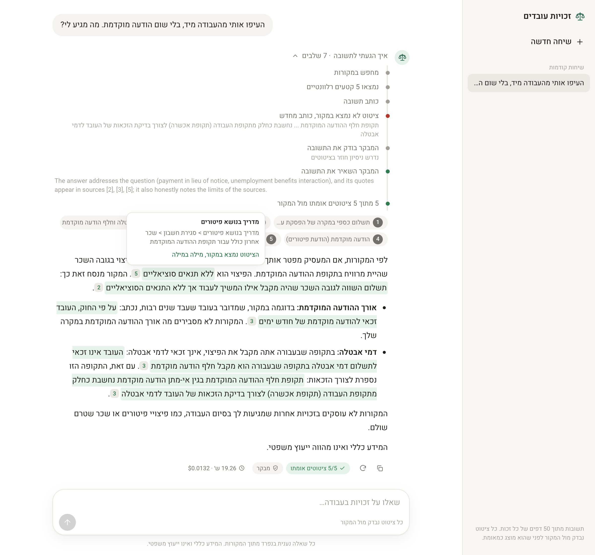
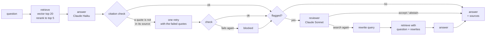
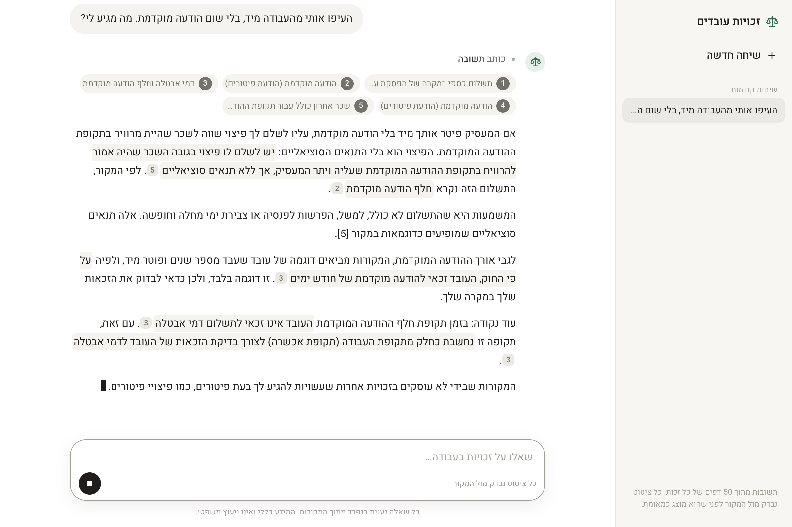

# Rights RAG

A question-answering system for Israeli employment rights, in Hebrew, built on
50 pages of the [Kol Zchut](https://www.kolzchut.org.il) website. It answers
questions like *"I was fired on the spot with no notice. What am I owed?"*,
quotes the passages it relies on, and checks every quote against its source
in code before the answer is marked as verified.

This is a portfolio project that demonstrates building a RAG system **by
measurement**. Every component was added as one change, measured against the
version before it on a labeled question set, and kept only if the numbers
supported it. Several reasonable ideas were measured and dropped; they are
reported below with the ones that worked.



*A real answer. One quote was not found word for word in its source, so the
model rewrote the answer; a reviewer model then checked it and kept it. All
five quotes are verified.*

## What it demonstrates

- **Retrieval on hard documents.** Hebrew PDFs (right-to-left text, tables
  drawn as graphics) and Word files loaded into the same structured sections,
  chunked by document structure, embedded and reranked with multilingual
  models.
- **Prompt engineering as a measured process.** Four prompt versions (v0 to
  v1.2), each a single change with a stated reason and a before/after table.
- **Hallucination control that does not rely on the model.** Answers must
  quote their sources as `«quote» [n]`; code checks each quote, retries once,
  and blocks what it cannot verify.
- **An agentic step with bounded decisions.** A LangGraph graph where cheap
  checks decide *when* to review an answer and a stronger model decides *what*
  to do: accept, abstain, or rewrite the query and search again (at most once).
- **Evaluation design.** A golden set labeled with exact source sentences,
  deterministic metrics first and an LLM judge second, a held-out test split,
  and a separate hand-written question set to check the first set for bias.
- **A complete application.** CLI, REST API with streaming, a chat client,
  tests that need no API key, and CI.

## How a question is answered



1. **Retrieve.** The question is embedded with `multilingual-e5-large` and
   matched against chunks in Chroma. The top 20 are reordered by a
   cross-encoder (`bge-reranker-v2-m3`) and the best 5 go to the model.
2. **Answer.** Claude Haiku answers from the numbered sources only, in
   Hebrew, citing each claim as `«exact quote» [n]`. If the sources do not
   answer the question it replies with one fixed sentence.
3. **Check citations.** Code verifies that every quote appears in source `n`.
   On failure the model gets one retry with the failed quotes listed; if that
   fails too, the answer is replaced with "could not verify".
4. **Review, when flagged.** An answer is flagged if it needed the retry, was
   blocked, or abstained (about one answer in three on the dev set). A reviewer (Claude
   Sonnet) sees the question, sources, answer and the list of pages in the
   collection, and chooses to accept, abstain, or search again with rewritten
   queries.
5. **Stream.** The API sends each step as it happens (server-sent events);
   the client shows progress, the answer as it is written, and marks each
   quote verified or not once the check has run.



## How it was evaluated

**Corpus.** 50 Kol Zchut pages on dismissal, resignation, notice, severance,
wages, hours, leave, parenthood, pensions and unemployment. 28 saved as PDF,
22 as HTML converted to Word, to exercise both loaders. Many pages cover
close topics with similar numbers, which makes retrieval genuinely hard.

**Golden set.** 143 questions in Hebrew, written the way a worker would ask:

| Set | Questions | Use |
|---|---|---|
| dev | 73 (51 answerable, 22 not) | all tuning |
| test | 32 (20 answerable, 12 not) | run once per milestone |
| hand-written | 38 (including 10 in slang) | a check on the dev/test set, written separately |

Questions cover simple facts, exact numbers, conditions, negations and
exceptions, confusable topics, two-fact answers, tables, and questions the
corpus does not answer (near topics, so "I don't know" is the right answer).
Each answerable question is labeled with the **exact sentences** that answer
it, not with chunk ids, so the same labels score every chunking strategy.

**Metrics.** Deterministic first:

- *Retrieval:* Hit@k (every fact of the answer appears verbatim in the top k
  chunks) and MRR.
- *Answers:* key facts present (short answer keys), abstention on unanswerable
  questions and false abstention on answerable ones, quotes found in their
  source, length, cost.
- *LLM judge (secondary):* Claude Haiku labels each answer correct, partial,
  unsupported, incorrect, abstained or hallucinated. It agrees with the
  deterministic keys on 70–90% of questions, so it is reported but never used
  alone. A first version of the judge, which saw only the reference facts,
  rated the bare prompt *higher* than the improved one: it could not see that
  the bare prompt answered from memory. The second version also sees the
  sources.

Every run saves raw outputs, so scores can be recomputed without calling a
model. Score summaries of the runs behind each table are in
[`eval/results/`](eval/results/); the raw runs contain page text and are kept
out of the repository.

## Results

Each step changes one thing. Numbers are on dev unless marked otherwise.

### 1. Chunking

| Strategy | Hit@5 | MRR |
|---|---|---|
| Fixed 400 characters, 60 overlap | 0.56 | 0.42 |
| One chunk per paragraph, bullet or table row | 0.50 | 0.36 |
| Same, with the section path prepended | 0.64 | 0.46 |
| **Neighbouring units in a section merged up to 600 characters, with the section path** | **0.78** | **0.59** |

Small units lose context, the section heading restores some of it, and
merging neighbours restores the rest. Test split: 0.75 → 0.85.

### 2. Hybrid search: dropped

| | Hit@5 |
|---|---|
| Vector | **0.78** |
| BM25 | 0.50 |
| Vector + BM25 (reciprocal rank fusion) | 0.68 |
| Same, with Hebrew prefix stripping for BM25 | 0.72 |

Hebrew attaches prefixes (ו, ה, ב, ל, מ, ש, כ) to words, which hurts keyword
search. Stripping them helped BM25, but fusion still lost to vectors alone.

### 3. Reranking

| | Hit@1 | Hit@5 | Hit@10 | MRR | ms / question |
|---|---|---|---|---|---|
| Vector | 0.44 | 0.78 | 0.86 | 0.59 | – |
| **Rerank top 20** | 0.54 | **0.88** | 0.90 | 0.67 | 1,100 |
| Rerank top 50 | 0.56 | 0.88 | 0.94 | 0.69 | 2,500 |

Same Hit@5 from 20 candidates at less than half the time. Test split: 0.85 →
0.95. On the hand-written set the reranker did not change Hit@5 (0.83) but
raised Hit@10 from 0.87 to 0.96.

### 4. The answer prompt

| | v0: bare | v1: rules and numbered sources |
|---|---|---|
| Key facts in answer | 0.97 | 0.97 |
| Judge: correct / unsupported | 0.76 / 0.20 | 0.84 / 0.04 |
| Quotes found in their source | – (no citations) | 257 / 257 |
| Abstained on 34 hard unanswerable questions | 65% | **100%** |

v1 puts instructions in English and asks for Hebrew answers, marks the
sources as data rather than instructions, requires `«quote» [n]` citations,
states conditions, prefers the newer source when sources conflict, and gives
an exact sentence for "the sources do not cover this". v0 knew the facts
equally well but added claims the sources did not support.

v1.1 fixed a side effect: when it could not answer, v1 explained at length
what the sources *did* say (410 characters on average). v1.1 answers with the
abstention sentence alone (71 characters), and shortened answerable answers
from 972 to 785 characters.

### 5. Held-out test split (run once)

| | v0, Sonnet | v1.1, Sonnet | **v2, Haiku** |
|---|---|---|---|
| Abstained on unanswerable | 0.42 | 1.00 | 0.92 |
| Judge: hallucinated on unanswerable | 0.17 | 0.00 | 0.00 |
| Key facts | 1.00 | 1.00 | 1.00 |
| Answers with citations | 0.00 | 1.00 | 1.00 |
| Quotes found in their source | – | 0.99 | 1.00 |
| Cost | $0.27 | $0.32 | **$0.03** |

### 6. A cheaper model, made safe by the citation check

| | Sonnet v1.1 | Haiku v1.1 | Haiku, check that blocks | **Haiku, check with one retry (v2)** |
|---|---|---|---|---|
| Key facts after the check | 0.94 | – | 0.86 | **0.94** |
| Quotes found in their source | 1.00 | 0.98 | 1.00 | 1.00 |
| Cost | $0.78 | $0.06 | $0.06 | $0.06 |

Haiku's failed quotes were near misses (a dropped parenthesis, a changed
plural, "..." inside a quote), not inventions. Blocking alone discarded
correct answers; one retry with the failed quotes listed fixed 5 of 6. Result:
Sonnet's accuracy at a twelfth of the cost.

### 7. Query rewriting: only on demand

| Hit@5 | dev | hand-written | slang only |
|---|---|---|---|
| The user's question | **0.88** | **0.88** | **1.00** |
| Haiku's rewritten queries | 0.78 | 0.91 | 0.83 |
| Question and rewrites together | 0.80 | 0.88 | 0.83 |

The expected slang problem did not exist: all 10 slang questions were
retrieved without help. Rewriting every question hurt, because rewrites drop
specifics. But on the 8 questions where retrieval had missed, rewriting found
the answer for 6. So rewriting runs only when the reviewer asks for it.

### 8. The reviewer, tested on its own before use

57 saved answers with known correct actions:

| Case | Without the page list | **With the page list** |
|---|---|---|
| Correct abstention left alone | 3 / 38 | **35 / 38** |
| Good answer accepted | 15 / 16 | 16 / 16 |
| Failed answer sent to search again | 2 / 3 | 2 / 3 |

Sonnet knows the whole Kol Zchut website and kept sending correct abstentions
back to search ("Kol Zchut has a page on polygraph tests"). Giving it the
titles of the 50 pages actually indexed fixed this. In a live loop the first
version would have doubled the cost of every unanswerable question.

### 9. The review loop (v3)

| | v2.1 | **v3** |
|---|---|---|
| Key facts | 0.94 | 0.94 |
| Quotes found in their source | 1.00 | 1.00 |
| Answers sent to the reviewer | – | 32% |
| Searched again | – | 1 question |
| Cost | $0.07 | $0.28 |

The reviewer rescued one question every earlier version abstained on and
broke none, at four times the cost (still a third of Sonnet answering alone).
It is on by default; the API can turn it off per request.

## What did not work, and what that taught

- **Hybrid search** lost to vectors on Hebrew without a proper analyzer.
- **Always-on query rewriting** cost more retrieval quality than it gained.
- **A judge that cannot see the sources** rewards confident answers from
  memory.
- **A strong reviewer without context** about what is indexed judges against
  everything it knows, and second-guesses correct "I don't know"s.
- **Blocking unverifiable quotes without a retry** throws away good answers;
  the retry is what made the cheaper model usable.

## Limits

- **Small evaluation set.** Most differences above are one or two questions.
  The dev and test questions were written with an LLM; the hand-written set
  scored similarly, which suggests limited bias, but does not rule it out.
- **The judge is noisy** (70–90% agreement with the deterministic keys).
- **Flags catch about half of the wrong answers.** An answer that is confident
  but incomplete, because the right passage was not retrieved, is not
  flagged, so the reviewer never sees it.
- **Partial answers to unanswerable questions.** Haiku sometimes says the
  sources do not cover the question and then adds related facts. The judge
  counts these as honest; the exact-sentence metric does not.
- **No conversation memory.** Each question is answered on its own.
- **No update dates for pages saved as PDF**, so "prefer the newer source"
  only works for the HTML pages.
- **Single user.** The API has no authentication.
- **Not legal advice.** Every answer says so.

## Project layout

```
src/rights_rag/
  loaders/          PDF (right-to-left repair, drawn tables) and DOCX loaders
  html_to_docx.py   saved HTML pages to Word
  corpus.py         manifest and metadata for the 50 pages
  chunking.py       fixed, unit and structure strategies
  index.py          embeddings, Chroma collections, incremental sync
  retrieval.py      vector, BM25, fusion, reranker
  prompts.py        every prompt version, v0 to v1.2
  answer.py         Claude calls, citation check and retry
  rewrite.py        query rewriting
  critic.py         the reviewer
  graph.py          the LangGraph pipeline (v3)
  service.py, api.py, ask.py, events.py   response, REST API with streaming, CLI
  golden.py, eval_*.py, results.py        golden set, evaluations, summaries
eval/golden.jsonl   the questions and their labels
eval/results/       score summaries of the runs reported above
web/                React chat client
tests/              59 tests with fake models
```

## Running it

Requires Python 3.12 with [uv](https://docs.astral.sh/uv/), Node 22, and an
Anthropic API key.

```bash
uv sync
cp .env.example .env            # add ANTHROPIC_API_KEY
uv run pytest                   # fake models, no key needed
```

The Kol Zchut pages are not in the repository. [`docs/sources.md`](docs/sources.md)
lists the 50 pages and how to save each one. Then build the index:

```bash
uv run python -m rights_rag.html_to_docx     # docs/html -> docs/docx
uv run python -m rights_rag.corpus           # docs/manifest.json
uv run python -m rights_rag.index --strategy structure --headings
```

Ask from the command line, or run the API and the client:

```bash
uv run python -m rights_rag.ask "פוטרתי בלי הודעה מוקדמת. מה מגיע לי?"
uv run uvicorn rights_rag.api:app          # POST /ask, POST /ask/stream
cd web && npm install && npm run dev       # http://localhost:5173
```

Evaluate:

```bash
uv run python -m rights_rag.eval_retrieval --experiment rerank
uv run python -m rights_rag.eval_answer --versions v2.1 v3 --judge
uv run python -m rights_rag.eval_answer --rescore eval/runs/<file>.json   # no model calls
uv run python -m rights_rag.eval_critic
uv run python -m rights_rag.results          # rewrite eval/results/
```

## License

The code is MIT licensed. The Kol Zchut pages are not included; quotations in
`eval/golden.jsonl` remain the property of Kol Zchut. This project is not
affiliated with Kol Zchut.
