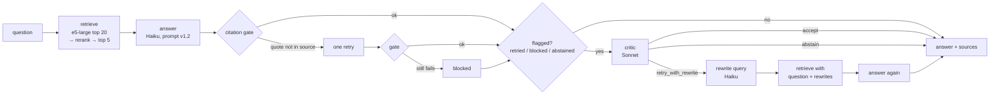

# Rights RAG

Question answering over Israeli employment rights, in Hebrew, from 50 pages of
the [Kol Zchut](https://www.kolzchut.org.il) website. Every answer quotes its
sources, and every quote is checked in code before the answer is returned.

The point of the project is the process: each step changes one thing, is
measured against the step before, and stays only if the numbers say so.
Several ideas did not survive (hybrid search, always-on query rewriting), and
the tables below show why.

## Highlights

- **Structure-aware loading of Hebrew PDFs and DOCX**: right-to-left text
  repaired, tables kept as `header: value` rows, headings turned into section
  paths. The same page loads to the same sections from either format.
- **Chunking by structure + section heading**: Hit@5 0.56 → 0.78 over
  fixed-size chunks.
- **Multilingual reranker** (bge-reranker-v2-m3): Hit@5 0.78 → 0.88.
- **Citation gate**: an answer whose `«quote» [n]` is not word for word in
  source `n` gets one retry, then is blocked. 100% of returned quotes verified.
- **Prompt that knows when to stop**: on questions the sources do not answer,
  abstention went from 42% (bare prompt) to 100% (held-out test split).
- **Haiku instead of Sonnet** for answers at 1/11 of the cost, with the same
  key facts after the gate.
- **A LangGraph review round**: cheap flags decide when to review; a Sonnet
  critic decides whether to accept, abstain, or rewrite the query and search
  again.
- **Evaluation in code**: a golden set labeled by exact source sentences (not
  chunk ids), answer keys, a held-out test split, 38 questions written
  separately to check the set's bias, raw runs saved and re-scorable without
  model calls. 57 tests with fake models, no API key needed.

## How it works



| Part | Choice | Where |
|---|---|---|
| Loaders | PyMuPDF (RTL repair, drawn tables), python-docx | `loaders/` |
| Chunks | paragraph, bullet or table row, merged within a section up to 600 chars, section path prepended for embedding | `chunking.py` |
| Embeddings | `intfloat/multilingual-e5-large`, local | `index.py` |
| Store | Chroma, one collection per strategy, content-hash ids, incremental sync | `index.py` |
| Reranker | `BAAI/bge-reranker-v2-m3` over the vector top 20 | `retrieval.py` |
| Answers | Claude Haiku 5.5; prompts in English, answers in Hebrew | `prompts.py`, `answer.py` |
| Review | LangGraph graph, Sonnet 5.5 critic, at most one round | `graph.py`, `critic.py` |
| Interfaces | CLI, FastAPI `POST /ask`, React client | `ask.py`, `api.py`, `web/` |

## Results

All tuning was done on the dev split. The test split (one in three questions
of each type) was run once per milestone. Retrieval scores are Hit@k: every
fact of the answer appears verbatim in the top k chunks.

### 1. Chunking (dev, 50 answerable questions)

| Strategy | Hit@5 | MRR |
|---|---|---|
| Fixed 400 chars, 60 overlap | 0.56 | 0.42 |
| One chunk per paragraph / bullet / row | 0.50 | 0.36 |
| Same, with the section path | 0.64 | 0.46 |
| **Units merged within a section (≤600), with the section path** | **0.78** | **0.59** |

Small units alone lose context; the heading puts it back; merging neighbours
in the same section adds the rest.

### 2. Hybrid search (dev)

| | Hit@5 |
|---|---|
| Vector | 0.78 |
| BM25 alone | 0.50 |
| Vector + BM25, RRF | 0.68 |
| Vector + BM25 with Hebrew prefix stripping, RRF | 0.72 |

BM25 hurt. Hebrew attaches prefixes (ו, ה, ב, ל, מ, ש, כ) to words; stripping
them helped BM25 but not enough. Dropped.

### 3. Reranking (dev)

| | Hit@1 | Hit@5 | Hit@10 | MRR | ms / question |
|---|---|---|---|---|---|
| Vector | 0.44 | 0.78 | 0.86 | 0.59 | – |
| **Rerank top 20** | 0.54 | **0.88** | 0.90 | 0.67 | 1,100 |
| Rerank top 50 | 0.56 | 0.88 | 0.94 | 0.69 | 2,500 |

Same Hit@5 at 20 candidates, less than half the time. Held-out test split:
fixed 0.75 → structure 0.85 → rerank 0.95.

### 4. The answer prompt (dev, Sonnet)

| | v0: bare | v1: rules + numbered sources | v1.1: abstention only as a whole answer |
|---|---|---|---|
| Key facts in answer | 0.97 | 0.97 | 0.97 |
| Judge: correct / unsupported | 0.76 / 0.20 | 0.84 / 0.04 | 0.82 / 0.00 |
| Answer length, answerable (chars) | 748 | 966 | 785 |

v1 adds numbered sources marked as data, `«quote» [n]` citations, conditions,
conflict handling (newer source wins, older one quoted) and an exact
abstention sentence. On 34 hard unanswerable questions (near topics the corpus
does not cover), v1 abstained on 100%, v0 on 65%. v1.1 stopped v1 from
explaining what the sources do say when they do not answer: answers to
unanswerable questions went from 410 to 71 characters.

### 5. Held-out test split (32 questions, run once)

| | v0, Sonnet | v1.1, Sonnet | **v2, Haiku** |
|---|---|---|---|
| Abstained, unanswerable | 0.42 | 1.00 | 0.92 |
| Key facts | 1.00 | 1.00 | 1.00 |
| Answers with citations | 0.00 | 1.00 | 1.00 |
| Citations found in source | – | 0.99 | 1.00 |
| Judge: hallucinated, unanswerable | 0.17 | 0.00 | 0.00 |
| Cost | $0.27 | $0.32 | **$0.03** |

### 6. Haiku and the citation gate (dev)

| | Sonnet v1.1 | Haiku v1.1 | Haiku + gate, no retry | **Haiku v2: gate + one retry** |
|---|---|---|---|---|
| Key facts after the gate | 0.94 | – | 0.86 | **0.94** |
| Citations found in source | 1.00 | 0.98 | 1.00 | 1.00 |
| Cost | $0.78 | $0.06 | $0.06 | $0.06 |

Haiku's failed quotes were near misses (a dropped parenthesis, a changed
plural, "..." inside a quote), not inventions. Blocking alone threw away
correct answers; one retry with the failed quotes listed fixed 5 of 6.

### 7. Query rewriting (retrieval only)

| Hit@5 | dev | hand-written set | slang questions |
|---|---|---|---|
| Question | **0.88** | **0.88** | **1.00** |
| Haiku rewrites only | 0.78 | 0.91 | 0.83 |
| Question + rewrites | 0.80 | 0.88 | 0.83 |

The expected slang problem did not exist: all 10 slang questions were
retrieved without help. Rewriting every question hurt, because rewrites drop
specifics. On the questions retrieval had missed, it found the answer for 6
of 8. So rewriting is used only when the critic asks for it.

### 8. The critic, measured alone (57 saved answers)

| Case | Without page list | With page list |
|---|---|---|
| Correct abstention kept | 3 / 38 | **35 / 38** |
| Good answer accepted | 15 / 16 | 16 / 16 |
| Failed answer sent to search again | 2 / 3 | 2 / 3 |

Sonnet knows the whole Kol Zchut website and kept sending correct abstentions
back to search ("Kol Zchut has a page on polygraph tests"). Giving it the
titles of the 50 pages actually indexed fixed it.

### 9. The review round (v3)

| | dev: v2.1 | dev: **v3** |
|---|---|---|
| Key facts | 0.94 | 0.94 |
| Citations found in source | 1.00 | 1.00 |
| Sent to the critic | – | 32% |
| Searched again | – | 1 question |
| Cost | $0.07 | $0.28 |

The critic rescued one question that every earlier version abstained on, and
broke none. A small gain for 4× the cost, still a third of Sonnet answering
alone. It is on by default and can be turned off per request.

## Limits

- **Small evaluation set.** 105 questions written by Claude (dev 73, test 32)
  and 38 written by hand. Many differences above are one or two questions.
- **The LLM judge is noisy.** Haiku agrees with the deterministic answer keys
  on 70–90% of questions; it is reported as a secondary metric only.
- **Flags catch half of the bad answers.** An answer that is confident and
  incomplete (the right page was not retrieved, and the model did not notice)
  is not flagged, so the critic never sees it.
- **Partial answers on unanswerable questions.** Haiku sometimes says "the
  sources do not cover this" and then adds related facts. The judge counts
  these as honest abstentions; the exact-sentence metric does not.
- **No dates for PDF pages**, so the "newer source wins" rule only works for
  pages saved as HTML.
- **Single user, no access control.** The API has no authentication.
- **Not legal advice.** Every answer says so.

## Running it

Requires Python 3.12 with [uv](https://docs.astral.sh/uv/), Node 22, and an
Anthropic API key.

```bash
uv sync
cp .env.example .env            # add ANTHROPIC_API_KEY
uv run pytest                   # fake models, no key needed
```

The Kol Zchut pages are not in the repository. `docs/sources.md` lists the 50
pages and how to save each one (PDF from the browser, or HTML that is
converted to DOCX). Then:

```bash
uv run python -m rights_rag.html_to_docx       # docs/html -> docs/docx
uv run python -m rights_rag.corpus             # writes docs/manifest.json
uv run python -m rights_rag.index --strategy structure --headings
```

Ask:

```bash
uv run python -m rights_rag.ask "עבדתי שנה וחצי בשכר שעתי ופוטרתי. כמה זמן מראש היו צריכים להודיע לי?"
uv run uvicorn rights_rag.api:app        # POST /ask {"question": "...", "critic": true}
cd web && npm install && npm run dev     # http://localhost:5173
```

Evaluate:

```bash
uv run python -m rights_rag.eval_retrieval --experiment rerank
uv run python -m rights_rag.eval_answer --versions v2.1 v3 --judge
uv run python -m rights_rag.eval_answer --rescore eval/runs/<file>.json   # no model calls
uv run python -m rights_rag.eval_critic
```

Source pages © Kol Zchut. This project is for learning and is not affiliated
with Kol Zchut.
